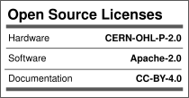

## License

| Component | License |
|---|---|
| Hardware design files (KiCad) | [CERN-OHL-P-2.0](LICENSE-HARDWARE) |
| Firmware | Apache-2.0 ([firmware repo](PASTE_FIRMWARE_REPO_URL)) |
| Documentation | [CC-BY-4.0](LICENSE-DOCS) |

## Credits

Derived from the Golioth Aludel Elixir (CERN-OHL-P-2.0), designed by
Chris Gammell, which itself descends from Jared Wolff's nRF9160 Feather.
Changes: RP2350B + ESP32-C3 architecture, OKW IN-BOX form factor,
sensor/relay/buzzer sections, and DFT test features.
