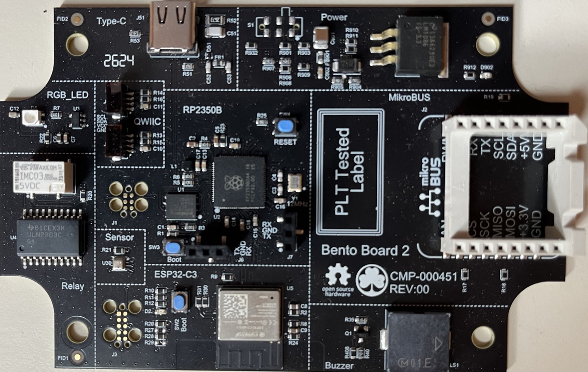
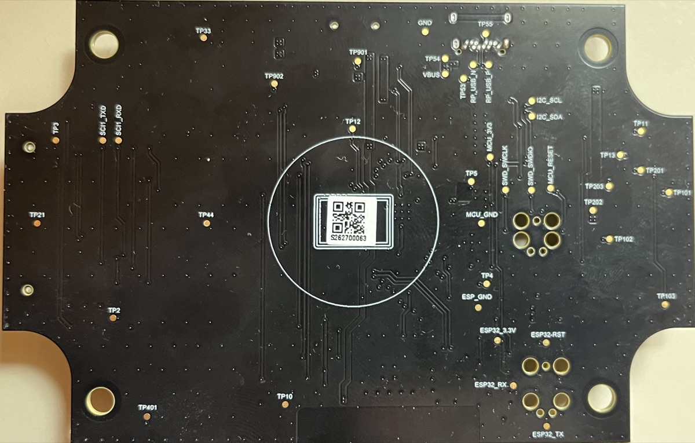
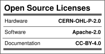

# Bento Board

Open-source hardware sample board from Blue Clover Devices, used to
demonstrate PLT production test workflows. An RP2350B host MCU and an
ESP32-C3 wireless module sit alongside RGB LED, relay, sensor, buzzer,
QWIIC and MikroBUS sections, in an OKW IN-BOX form factor. The board
includes dedicated test points and Tag-Connect footprints for fixture-based test.

| Top | Bottom |
|---|---|
|  |  |

## Resources

- [PLT docs: Bento Board sample](https://docs.pltcloud.com/samples/board/bento/)
- [Bento PLT test plans](https://github.com/bcdevices/test-plans/tree/main/bento)
- [Bento Zephyr firmware](https://github.com/bcdevices/bento-zephyr-fw)

## Layout

```
bento-board/
├── kicad/              KiCad source projects (open the .kicad_pro)
│   ├── library/        Shared symbol + footprint library
│   ├── rev0/           SUB-00156 REV00
│   └── rev1/           SUB-00156 REV01
├── schematic/          Schematic exports (PDF, SVG), per revision
│   ├── rev0/
│   └── rev1/
├── layout/             Board renders and fabrication outputs, per revision
│   ├── rev0/
│   └── rev1/
├── firmware/           Prebuilt firmware images
│   └── blinky/
├── images/             Board photos
└── test/               PLT test plans
    └── flash-blinky/
```

Each `kicad/revN/` directory is a complete KiCad project; the schematic and
PCB must stay together for KiCad's project linking to work. `schematic/` and
`layout/` hold generated outputs only.

## Revisions

| Rev | Changes |
|---|---|
| REV00 | Initial release |
| REV01 | Tag-Connect footprint moved away from relay; added 4.7 µF capacitor |

## License



| Component | License |
|---|---|
| Hardware design files (KiCad) | [CERN-OHL-P-2.0](LICENSE-HARDWARE) |
| Firmware | Apache-2.0 ([firmware repo](https://github.com/bcdevices/example-projects/tree/main/bento-board/firmware/blinky)) |
| Documentation | [CC-BY-4.0](LICENSE-DOCS) |

## Credits

Derived from the Golioth Aludel Elixir (CERN-OHL-P-2.0), designed by
Chris Gammell, which itself descends from Jared Wolff's nRF9160 Feather.
Changes: RP2350B + ESP32-C3 architecture, OKW IN-BOX form factor,
sensor/relay/buzzer sections, and DFT test features.
